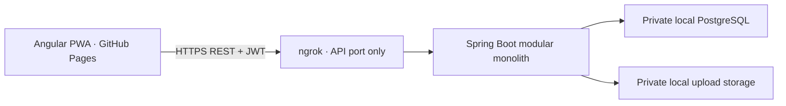

# My Society

A multi-society housing community application by **Sarvesh Barve**. One Angular PWA, one Spring Boot API, and one PostgreSQL database support multiple societies with independent memberships, roles, homes, and daily activity.

The UI includes **All rights reserved by Sarvesh Barve** on login and throughout the application.

## What works

- Global email/mobile and password login, BCrypt, one-hour JWT sessions, password changes with session revocation, and login throttling.
- Editable login email/mobile, one-time password recovery codes for every role, and verified Super Admin-assisted recovery for non-owner accounts.
- Six per-society colour themes configurable by Super Admin or a society administrator with Society Settings permission.
- Platform owner: create/edit/activate/suspend societies, create global users, assign memberships, edit branding and role permissions, inspect audits and diagnostics.
- Multiple memberships and multiple roles per society; switch communities without signing out.
- Buildings, optional wings/floors, flats, resident profiles, dated resident–flat links and individual staff accounts.
- Walk-in and expected visitors, resident approval/denial, gate check-in/out with valid time windows, notification polling and audit trails.
- Parcel receipt/collection/return; complaints with assignment, comments, status history and reopening.
- Notices with audiences, publication/expiry and acknowledgements.
- Meetings, participants, ordered agenda, attendance, discussions, decisions, resolutions, action tasks and approved/locked minutes. Print approved minutes or save them as PDF with the browser.
- Protected PDF/PNG/JPEG documents, version chains, notifications, emergency contacts, permission-aware search and CSV reports.
- Responsive resident, committee, gate and platform dashboards; English UI with common Marathi/Hindi translations; installable PWA shell.
- GitHub Pages workflow, HTTPS runtime API configuration, ngrok setup, local backup/restore scripts.

Finance, payments, OTP, formal voting, push notifications and other later modules are deliberately outside this MVP.

## Architecture



The platform name is stored in application settings. Society names and identity remain separate. Updating **Application branding** changes the application name without source edits.

Every society endpoint validates `X-Society-Id` against an active membership and permissions. SUPER_ADMIN has explicit platform-owner authority to manage societies. Resident visitors/parcels are further restricted to currently linked flats; private complaints, committee documents, targeted notices and restricted meetings receive additional backend checks. Requests cannot change the record’s tenant via JSON. Composite foreign keys validate tenant relationships at the database layer.

See [architecture and security](docs/ARCHITECTURE.md), [API guide](docs/API.md), and [implementation notes](docs/IMPLEMENTATION.md).

## Repository

```text
frontend/                 Angular 21, SCSS, reactive forms, routes, PWA, Vitest and Playwright
backend/                  Java 21, Spring Boot 3.5, Spring Security, JPA, Flyway, Maven wrapper
  src/main/java/com/mysociety/
    auth/ security/ platform/ society/ membership/ user/
    flat/ resident/ visitor/ parcel/ complaint/ notice/
    meeting/ task/ document/ notification/ emergency/ audit/ report/
docs/                     Deployment, ngrok, architecture, API and operational notes
scripts/                  Environment loading, startup, backups, restores and PWA preview
.github/workflows/        Verification and GitHub Pages deployment
docker-compose.yml        Optional loopback-only PostgreSQL
.env.example              Configuration keys; no usable credentials
```

## Prerequisites

Java 21, Node 22.12+ (22.14 verified), Git, and PostgreSQL 17. The Maven wrapper downloads Maven. Docker is optional. ngrok is needed only to connect the hosted frontend to a laptop backend.

Framework compatibility references: [Angular](https://angular.dev/reference/versions), [Spring Boot](https://docs.spring.io/spring-boot/3.5/system-requirements.html).

## Database and secrets

Copy `.env.example` to an ignored `.env`, fill all secrets, and adjust connection settings. Use a random JWT secret of at least 32 bytes and a unique owner password of at least 12 characters. Never commit this file.

With Docker:

```powershell
docker compose up -d postgres
```

The database port binds only to `127.0.0.1`. Set `POSTGRES_PORT` if 5432 is occupied and match the port in `SPRING_DATASOURCE_URL`.

With an existing PostgreSQL installation, create a private `mysociety` database and owner, and set the datasource variables. Create a separate **mysociety_test** database for integration tests.

On the implementation machine, portable PostgreSQL binaries are in ignored `.tools/postgres/pgsql`, data in `.local/postgres-data`, and PostgreSQL uses **127.0.0.1:5433** because another service occupied 5432. The existing 5432 service was preserved. See [local setup](docs/LOCAL_SETUP.md).

## Backend port and startup

**Selected API port: 8081.** Port 8080 was occupied and was left untouched.

```powershell
# From the repository root:
.\scripts\start-backend.ps1
```

The script imports `.env`, finds an available port starting from `SERVER_PORT`, prints the actual port, records it in `.local/backend-port.txt`, and updates the single local frontend runtime config. It never terminates an existing port owner.

Equivalent manual startup:

```powershell
. .\scripts\import-env.ps1
$env:SERVER_PORT = '8081'
Remove-Item Env:SPRING_PROFILES_ACTIVE -ErrorAction SilentlyContinue
cd backend
.\mvnw.cmd spring-boot:run
```

Production-like mode: omit `-Dev` (or remove `SPRING_PROFILES_ACTIVE`). That disables OpenAPI. Demo seeding is no longer part of the application in any profile. Flyway runs on startup; Hibernate validates the migrated schema rather than generating it.

Linux/macOS, after exporting the same environment variables:

```bash
cd backend
SERVER_PORT=8081 bash mvnw spring-boot:run
```

Verify [API health](http://localhost:8081/api/v1/system/health).

## Initial owner and demo accounts

The first owner is created only when no SUPER_ADMIN exists, using:

```text
INITIAL_SUPER_ADMIN_NAME
INITIAL_SUPER_ADMIN_EMAIL and/or INITIAL_SUPER_ADMIN_MOBILE
INITIAL_SUPER_ADMIN_PASSWORD
```

Changing those variables later does **not** reset an existing owner.

Normal startup never creates demo users, residents, visitors or societies, even with the dev profile. Test fixtures live only in `backend/src/test` and are not packaged in the production JAR.

Residents register at `/#/signup`, sign in, enter a society code and request access. An authorised administrator reviews **Join requests**, verifies the flat and approves an owner/tenant/family-member role. Signup alone grants no society permissions.

The owner password is generated locally in the ignored `.env`; the private handover is `.local/SUPER_ADMIN_ACCESS.md`. Changing bootstrap variables does not reset an existing account. See [Super Admin guide](docs/SUPER_ADMIN_GUIDE.md) for changing login details/password and saving recovery codes.


## Frontend

```powershell
cd frontend
npm ci
npm start
```

Open [local frontend](http://localhost:4200). The only local API URL is in `frontend/public/runtime-config.json`:

```json
{"apiBaseUrl":"http://localhost:8081","ngrokSkipBrowserWarning":false}
```

Production build:

```powershell
npm run build
```

## Hosted frontend and tunnel

```powershell
# The actual API port is 8081, not 8080:
ngrok http 8081
# Or use the port-aware wrapper:
.\scripts\start-ngrok.ps1
```

Set GitHub repository variable **API_BASE_URL** to the tunnel's HTTPS origin. Enable GitHub Pages with **GitHub Actions** as its source, then run **Deploy GitHub Pages**.

Hosted app: [sarvesh1barve.github.io/MySociety](https://sarvesh1barve.github.io/MySociety/).

Allowed backend origins:

```text
APP_CORS_ALLOWED_ORIGINS=http://localhost:4200,https://sarvesh1barve.github.io
```

The GitHub origin has **no repository path**. See [Pages deployment](docs/GITHUB_PAGES_DEPLOYMENT.md) and [ngrok setup](docs/NGROK_SETUP.md).

The laptop, database, backend, network and tunnel must remain running for live operations. The free frontend does not turn a local backend into an always-on service.

## Main routes

Hash routing supports refreshes on GitHub Pages.

```text
/#/login                 /#/select-society         /#/dashboard
/#/platform              /#/societies              /#/platform-users
/#/branding              /#/roles                  /#/diagnostics
/#/flats                 /#/buildings              /#/wings
/#/floors                /#/residents              /#/mappings
/#/society-users         /#/visitors               /#/parcels
/#/complaints            /#/notices                /#/meetings
/#/tasks                 /#/documents              /#/emergency-contacts
/#/reports               /#/search                 /#/notifications
/#/audit                 /#/system-audit           /#/profile
/#/settings
```

## PWA

Open the HTTPS hosted app and choose the browser's install/add-to-home-screen command. The service worker caches only the application shell, code, icons and translations. It does not cache authenticated API responses, JWTs, documents, private records or runtime configuration. A session token is tab-scoped in sessionStorage and removed on logout; it is never stored in service-worker caches.

Offline operations are intentionally disabled. Reconnection retrieves current approvals and records from the API.

## Verification

Backend integration tests use real PostgreSQL and reset only a database named `mysociety_test`:

```powershell
. .\scripts\import-env.ps1
.\backend\mvnw.cmd -f backend\pom.xml verify
cd frontend
npm test -- --watch=false
npm run build
npx playwright install chromium
npx playwright test
```

Mutating browser tests require the isolated loopback API on 8091 and `mysociety_e2e`. Start the frontend, build the backend test classpath, then run `scripts/run-browser-tests.ps1`. They cannot fall back to the live API. See docs/LOCAL_SETUP.md.

The tests cover login, membership/role isolation, society switching, visitor lifecycle, flat privacy, parcels, complaints, notices, minutes locks, protected documents, audits, CORS, runtime config, guards, mobile layout and failure messages.

## Backup and recovery

For owner login, account changes, recovery codes, society themes and full operating steps, read the [Super Admin guide](docs/SUPER_ADMIN_GUIDE.md). All users can generate one-time password recovery codes in their profile. Super Admin can assist non-owner accounts after identity verification; there is no public owner-account bypass.

```powershell
.\scripts\backup.ps1
.\scripts\restore.ps1 -BackupDirectory 'D:\path\to\backup' -NewDatabase mysociety_restore_check
```

Back up **both** PostgreSQL and uploads. Each backup has a unique destination; restore targets a new database and a separate uploads directory. See [backup guide](docs/BACKUP.md). Stop writes for a coordinated database/files snapshot.

## Troubleshooting

- **Server unavailable:** verify API health, the actual port, PostgreSQL, ngrok, `API_BASE_URL`, then CORS.
- **Login fails:** use the generated password for the matching account; owner bootstrap variables do not change an existing password.
- **No society/flat access:** ensure ACTIVE membership, an ACTIVE/TRIAL society, active resident profile and current flat mapping.
- **403:** changing IDs cannot grant access; check membership and permissions. A resident can approve visitors only for their own currently linked flat.
- **409:** another request changed the record or the requested transition is invalid. Refresh.
- **Missing private document:** check visibility and permissions, and restore the matching upload files if necessary.
- **Pages loads an old version:** let the service worker update, then reload. Runtime config is always fetched without caching.

## Operations and future migration

Use restricted OS access for `.env`, database data, uploads and backups. Never expose PostgreSQL through ngrok. API logs include safe error type/correlation IDs without credentials or JWTs. OpenAPI documentation is public only in dev; protected operations still require authentication. Production-like mode disables the documentation.

Moving to cloud hosting requires datasource/storage configuration and a new runtime API origin. `FileStorageService` can be replaced with an object-storage implementation without changing document authorization. See [known limits and next steps](docs/IMPLEMENTATION.md).

© 2026 Sarvesh Barve. All rights reserved.
